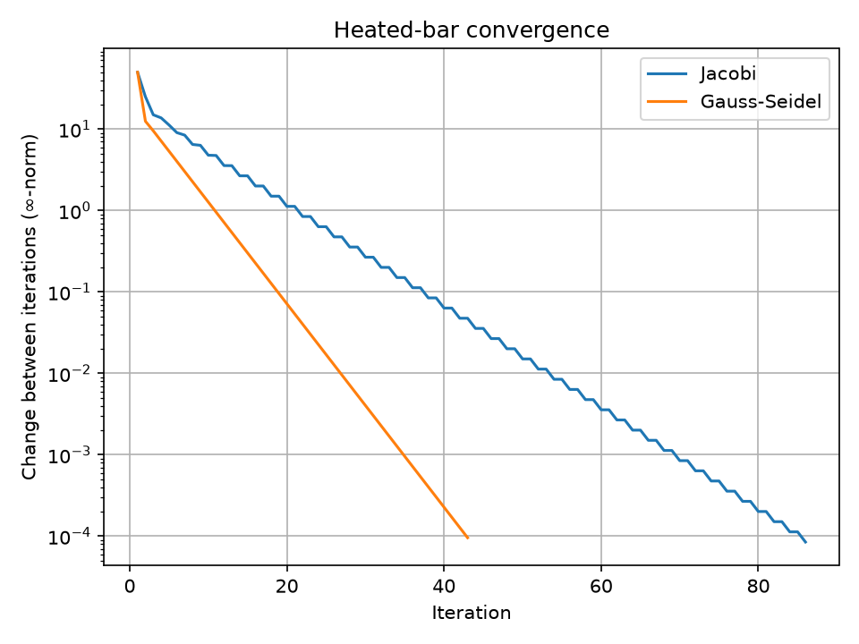
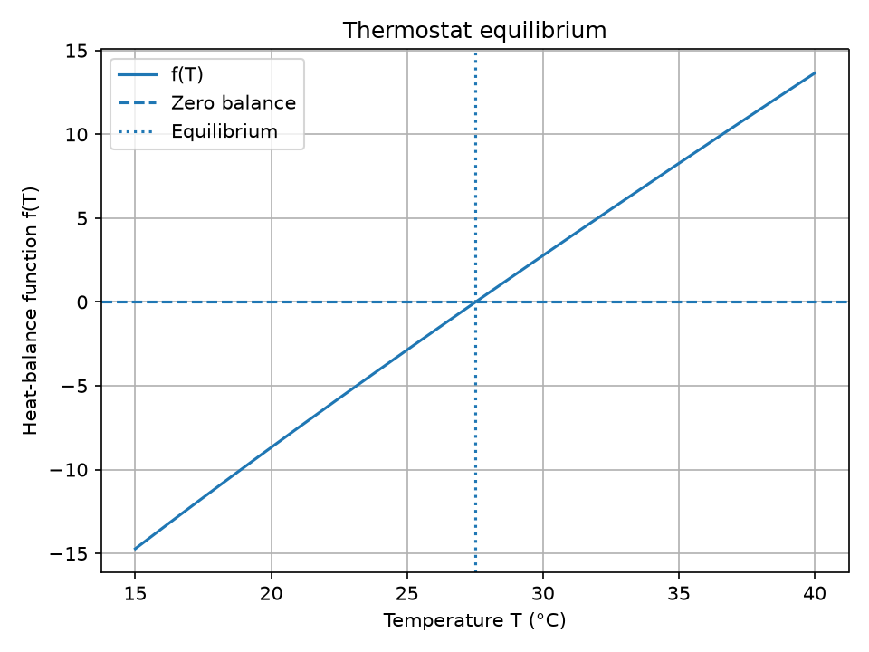
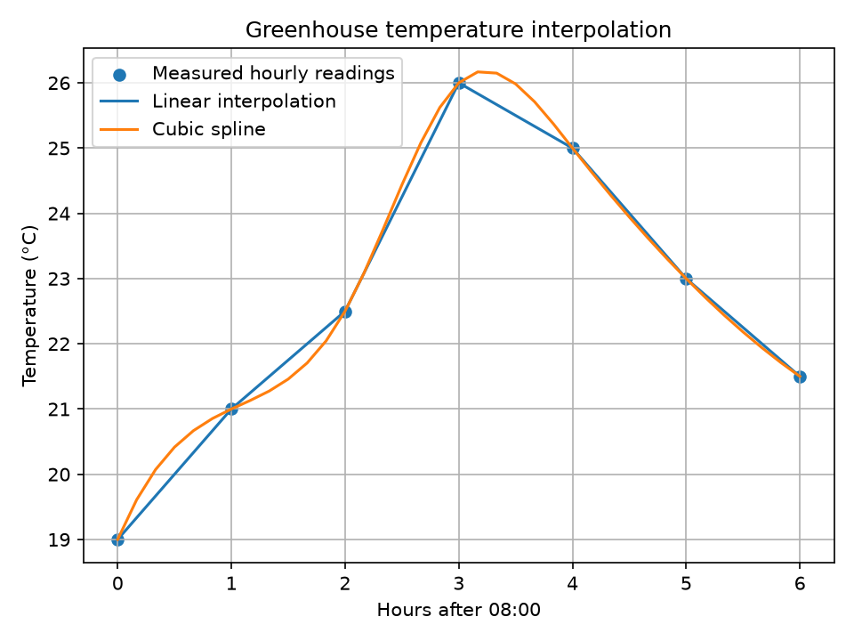
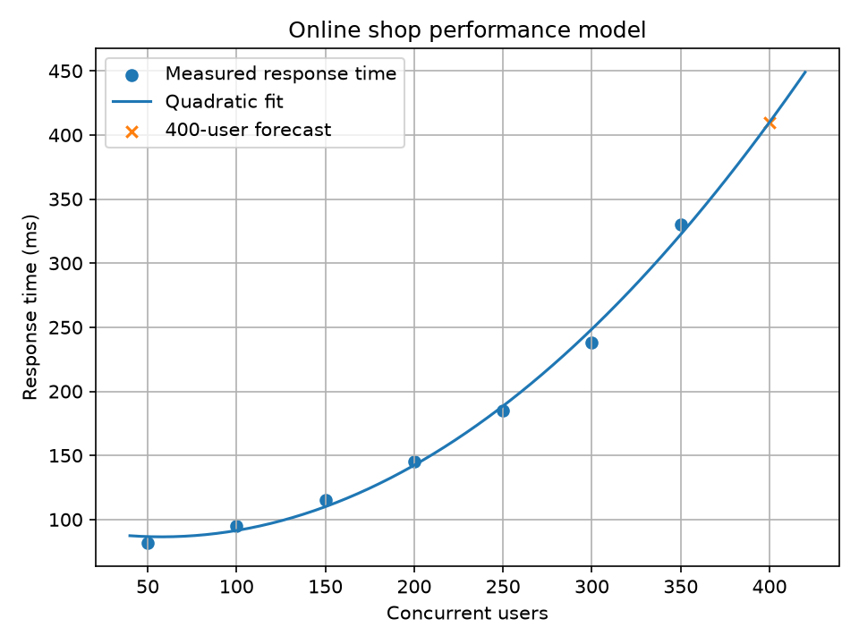
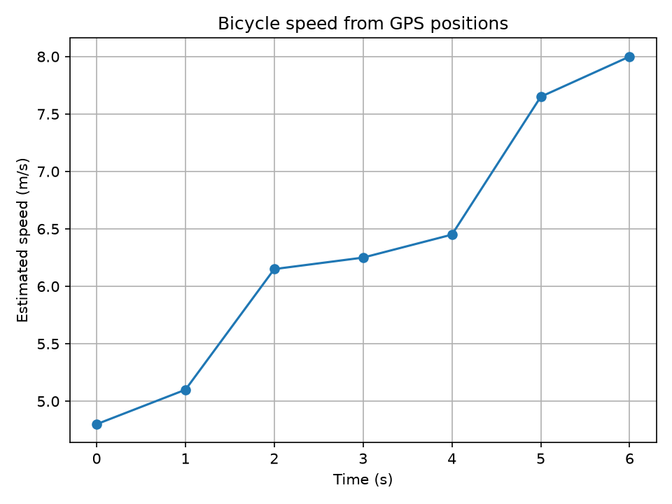
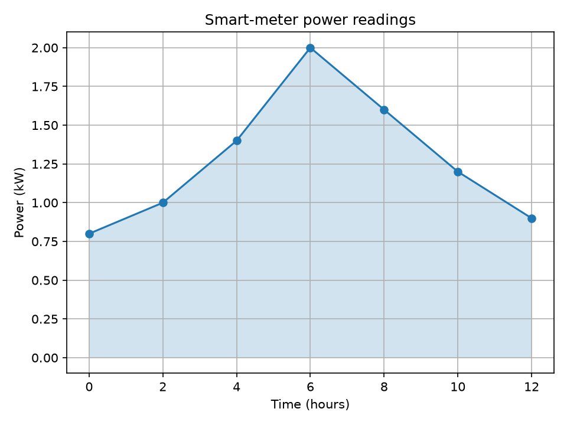
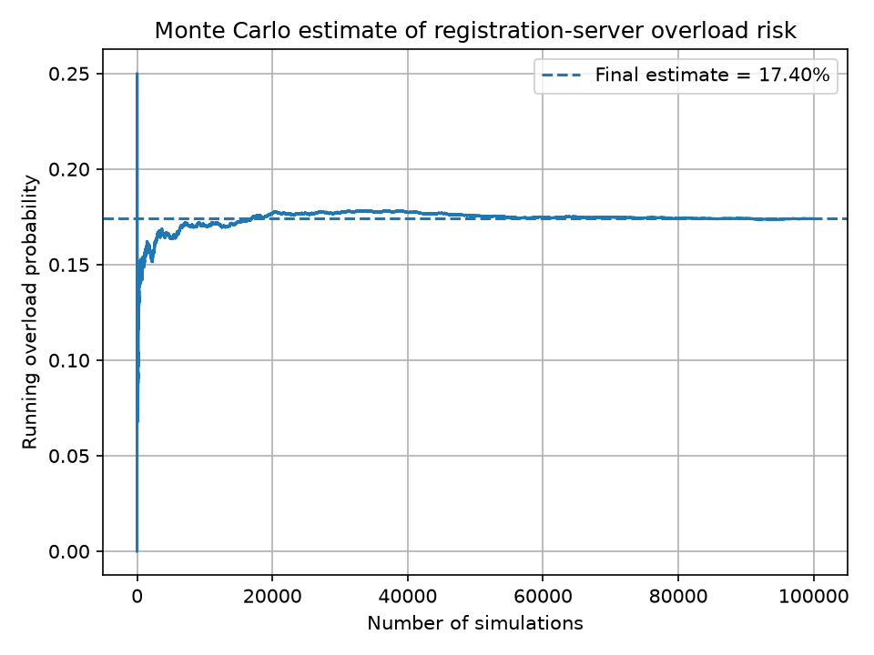

# BIT 2118: Scientific Computing in Python (Tasks 2 – 20)

**Student Name:** Ndabarishe Patrick  
**Registration Number:** BSCCS252613119  
**Unit:** BIT 2118 Scientific Computing  

This repository contains 19 applied scientific computing scripts and visualizations built with **NumPy**, **SciPy**, and **Matplotlib**. Each module models a real-world engineering, financial, or environmental scenario, evaluates parameter sensitivity by modifying key inputs, and verifies numerical accuracy through residuals, error norms, and graphical outputs.

---

## Tech Stack & Libraries
* **NumPy:** Multidimensional `ndarray` operations, vectorized arithmetic, linear algebra (`linalg.solve`, `linalg.eig`), polynomial fitting (`polyfit`), trapezoidal integration, and random number generation (`default_rng`).
* **SciPy:** LU factorization (`scipy.linalg.lu_factor`), scalar/multivariable root-finding (`root_scalar`, `newton`, `root`), interpolation (`interp1d`, `CubicSpline`), Simpson integration (`simpson`), ODE integration (`solve_ivp`), and constrained optimization (`minimize`).
* **Matplotlib:** Semi-log convergence plots, root-finding curves, interpolation comparisons, polynomial regression forecasts, and Monte Carlo stabilization charts.

---

## Complete Task Index & Visual Outputs

### 1. Arrays, Vectorization & Numerical Error
* **Task 2 — Greenhouse Temperature Monitoring** ([`Task_02_greenhouse.py`](Task_02_greenhouse.py)): Computes daily mean, minimum, and maximum temperatures across 24 hourly readings and performs vectorized Celsius-to-Fahrenheit conversion ($F = 1.8C + 32$). Changing the peak reading from $29.4^\circ\text{C}$ to $34.4^\circ\text{C}$ increases the maximum by $5^\circ\text{C}$ and shifts the daily mean upward by $5/24^\circ\text{C}$.
* **Task 3 — Website Latency Vectorization Benchmark** ([`Task_03_web_latency.py`](Task_03_web_latency.py)): Compares Python `for`-loop execution time against vectorized NumPy operations when converting 100,000 simulated latency logs (5–250 ms) into squared seconds.
* **Task 4 — Sensor Calibration & Floating-Point Error** ([`Task_04_sensor_error.py`](Task_04_sensor_error.py)): Evaluates binary floating-point representation (`0.1 + 0.2` vs `0.3` using `np.isclose`) and measures absolute and relative error when approximating $\sqrt{2}$ with `1.4142`.

---

### 2. Linear Algebra & Direct Linear Solvers
* **Task 5 — 2D Floor-Plan Transformation** ([`Task_05_floor_plan.py`](Task_05_floor_plan.py)): Combines rotation ($90^\circ$) and scaling ($2\times$ in $x$, $1.5\times$ in $y$) matrices to transform 2D coordinates, verifying via the matrix determinant ($\det = 3.0$) that area scales by $3\times$ while preserving orientation.
* **Task 6 — Server Resource Allocation Solver** ([`Task_06_machine_allocation.py`](Task_06_machine_allocation.py)): Solves $Ax = b$ via `np.linalg.solve` to estimate Type A and Type B machine counts from CPU and memory totals. Increasing CPU demand from 20 to 22 yields fractional estimates ($A = 3.6, B = 3.8$), demonstrating why real deployments require integer constraints.
* **Task 7 — Equipment Load Estimation via LU Decomposition** ([`Task_07_equipment_loads.py`](Task_07_equipment_loads.py)): Factors a fixed $3 \times 3$ system matrix once with `scipy.linalg.lu_factor` and solves multiple measurement sets efficiently using `lu_solve`.

---

### 3. Iterative Solvers & Eigenvalue Centrality
* **Task 8 — Heated-Bar Steady-State Temperatures** ([`Task_08_heated_bar.py`](Task_08_heated_bar.py)): Compares **Jacobi** and **Gauss-Seidel** iterative solvers against `np.linalg.solve` for a 5-node 1D heated bar with boundary conditions $[100, 0, 0, 0, 20]^\circ\text{C}$. With tolerance $10^{-4}$, Gauss-Seidel converges in roughly half the iterations (~43) needed by Jacobi (~86).



* **Task 9 — Office Network Device Ranking** ([`Task_09_device_network.py`](Task_09_device_network.py)): Computes the dominant eigenvalue and normalized eigenvector of an undirected adjacency matrix to rank structural centrality across office devices after removing the link between Laptop A and the Printer.

---

### 4. Nonlinear Root-Finding & Equation Systems
* **Task 10 — Thermostat Equilibrium Temperature** ([`Task_10_thermostat.py`](Task_10_thermostat.py)): Solves $f(T) = T - 25 - 10e^{-T/20} = 0$ using SciPy's bisection method (`root_scalar`) and fixed-point iteration from an initial guess of $35^\circ\text{C}$.



* **Task 11 — Equipment Investment IRR** ([`Task_11_equipment_irr.py`](Task_11_equipment_irr.py)): Calculates the Internal Rate of Return (IRR) where $\text{NPV}(\text{rate}) = 0$ for cash flows `[-10000, 3000, 3500, 4000, 2500]` using Newton-Raphson (`scipy.optimize.newton`, guess `0.15`) and the Secant method.
* **Task 12 — Circular Boundary & Path Intersections** ([`Task_12_path_intersections.py`](Task_12_path_intersections.py)): Solves the nonlinear system $x^2 + y^2 = 4$ and $y = x^2 - 1$ using `scipy.optimize.root` from starting guesses `[2.0, 2.0]` and `[-1.0, 1.0]`.

---

### 5. Interpolation, Regression, Differentiation & Integration
* **Task 13 — Greenhouse Temperature Interpolation** ([`Task_13_greenhouse_interpolation.py`](Task_13_greenhouse_interpolation.py)): Estimates greenhouse temperatures at 10-minute intervals between 08:00 and 14:00 (with 11:00 updated to $26.0^\circ\text{C}$), contrasting piecewise linear (`interp1d`) and smooth cubic spline (`CubicSpline`) curves.



* **Task 14 — Online Shop Performance Forecasting** ([`Task_14_shop_performance.py`](Task_14_shop_performance.py)): Fits a quadratic polynomial (`np.polyfit`) to server response times across 50–350 concurrent users (with 350-user latency updated to 330 ms), computes training RMSE, and extrapolates response time at 400 users (~410 ms).



* **Task 15 — Bicycle Speed from GPS Positions** ([`Task_15_bicycle_speed.py`](Task_15_bicycle_speed.py)): Estimates instantaneous bicycle speed (m/s) over 0–6 seconds (with $t = 3\text{ s}$ position set to 17.1 m) using forward, central, and backward finite differences.



* **Task 16 — Smart-Meter Electrical Energy Integration** ([`Task_16_meter_energy.py`](Task_16_meter_energy.py)): Integrates 2-hour smart-meter power readings (with 6-hour power updated to 2.0 kW) over 12 hours using both trapezoidal (`np.trapezoid`) and Simpson's (`scipy.integrate.simpson`) rules to estimate total energy in kWh.



---

### 6. Differential Equations, Optimization & Monte Carlo Simulation
* **Task 17 — Hot Drink Cooling (Euler Method)** ([`Task_17_hot_drink.py`](Task_17_hot_drink.py)): Numerically integrates Newton's law of cooling ($dT/dt = -k(T - T_{\text{ambient}})$) from $90^\circ\text{C}$ toward $25^\circ\text{C}$ using Euler's method and compares discretization error against the analytical solution.
* **Task 18 — RC Backup Circuit Charging (`solve_ivp`)** ([`Task_18_backup_circuit.py`](Task_18_backup_circuit.py)): Simulates capacitor charging $dV/dt = (V_s - V)/(RC)$ over 0–5 seconds using `scipy.integrate.solve_ivp` and compares numerical voltage against the exact exponential curve.
* **Task 19 — Least-Cost Compute Budget Optimization** ([`Task_19_compute_budget.py`](Task_19_compute_budget.py)): Minimizes server cost subject to a 1,200-unit capacity constraint using SLSQP (`scipy.optimize.minimize`), followed by a discrete grid search to identify the lowest-cost whole-unit server combination.
* **Task 20 — Registration-Server Overload Risk (Monte Carlo)** ([`Task_20_registration_risk.py`](Task_20_registration_risk.py)): Runs 100,000 seeded normal-demand simulations ($\mu = 850, \sigma = 160$) against a 1,000-request server capacity, estimating a **17.40%** overload probability and plotting running convergence.



---

## How to Run Locally

1. **Clone the repository:**
   ```bash
   git clone https://github.com
   cd your-repository-name
   ```

2. **Install required libraries:**
   ```bash
   pip install numpy scipy matplotlib
   ```

3. **Run any task script:**
   ```bash
   python Task_20_registration_risk.py
   ```
